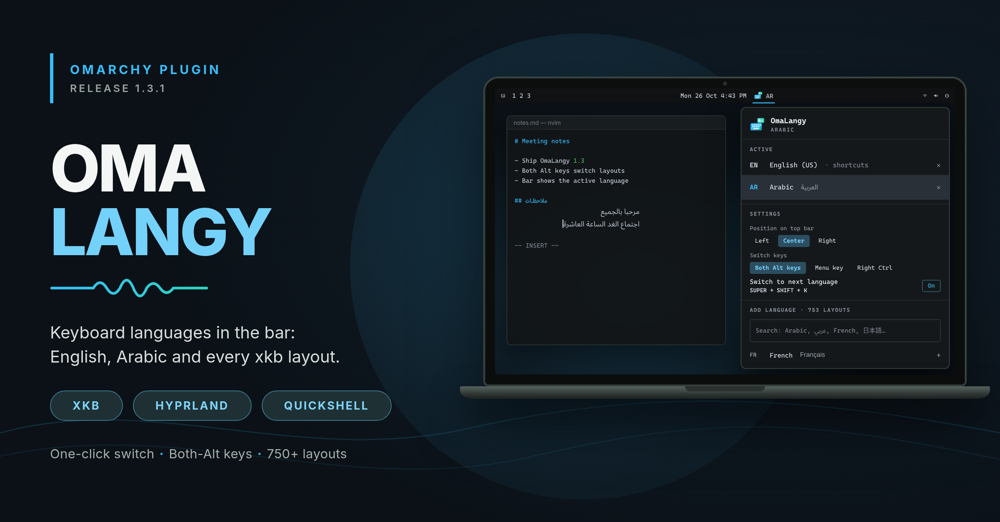

# OmaLangy: keyboard languages for Omarchy



A keyboard-language switcher for the Omarchy bar. It shows a small keyboard
icon and the current language code (`󰌌 EN`, `󰌌 AR`, ...). Click it to open a
panel where you can:

- **Switch** language by clicking it in the *Active* list
- **Add** any of the ~750 xkb layouts and variants: English, Arabic, French,
  Persian, Hebrew, Russian, Japanese and the rest. Search works in English or
  in the language itself (`Arabic`, `عربي`, `Français`, `日本語`)
- **Remove** a language (󰅖) or **reorder** it (󰁝)
- **Settings**: switch keys, bar label, and keybindings (see below)

On the bar itself: **left-click** opens the panel, **right-click** or
**scroll** switches to the next language.

## Keybindings

| Keys                      | Action                         | Notes |
|---------------------------|--------------------------------|-------|
| Left Alt + Right Alt      | Next language                  | Omarchy's own default for extra layouts |
| `SUPER + SHIFT + K`       | Next language                  | Hyprland binding, changeable |
| `SUPER + CTRL + ALT + K`  | Open the languages panel       | Hyprland binding, changeable |

All three were checked against every Omarchy binding. The plugin also guards
against future clashes:

- Before binding a key, it asks Hyprland whether anything else (Omarchy, your
  `bindings.lua`) already uses it. If so, it leaves its own shortcut off and
  the panel shows the clash in red, e.g. *Used by Omarchy: "Herdr keybindings"*.
- After every config reload (for example after `omarchy update`), it checks
  again. If a new Omarchy binding takes one of its keys, it drops its own
  binding and sends a notification, so two actions never fire on one key.
- Alt+Shift and Ctrl+Shift are deliberately **not** offered as switch keys:
  Omarchy uses Shift+Alt (Alt+Tab back, web-app shortcuts) and terminals use
  Ctrl+Shift+C / V. Caps Lock (compose), both Shifts (Caps Lock) and
  Super+Space (launcher) are taken too.

## Settings

Change them in the panel's **Settings** section, or from a terminal. They are
stored on the widget's entry in `~/.config/omarchy/shell.json`, like every
Omarchy widget setting, and declared in `manifest.json` (`defaults` + `schema`).

| Setting           | Values                                              | Default |
|-------------------|-----------------------------------------------------|---------|
| Position          | Left, Center, Right · Start, Next to clock, End     | Center, next to clock |
| `label`           | `Icon and code`, `Code only`, `Icon only`           | `Icon and code` |
| `switchKeys`      | `Both Alt keys`, `Menu key`, `Right Ctrl`, `Off`    | `Both Alt keys` |
| `nextLanguageKey` | any Hyprland combo, or empty to turn off            | `SUPER + SHIFT + K` |
| `panelKey`        | any Hyprland combo, or empty to turn off            | `SUPER + CTRL + ALT + K` |

Position is the widget's place in the bar layout, so the panel moves it with
`omarchy bar move` (the same as running it yourself):

```bash
omarchy bar move blackcode.omalangy --section right --index 0
omarchy bar move blackcode.omalangy --after omarchy.clock
omarchy bar set blackcode.omalangy label "Code only"
omarchy bar set blackcode.omalangy switchKeys "Menu key"
omarchy bar set blackcode.omalangy nextLanguageKey "SUPER + ALT + L"
omarchy bar set blackcode.omalangy panelKey ""
```

## Safe by design

- **Nothing changes until you ask.** Installing the plugin only adds the bar
  icon. Your Hyprland config is first touched when you add, remove or reorder
  a language, or change a switch key or keybinding in the panel. Until then
  the panel says "Not set up yet".

- Your languages are saved to their own file, `~/.config/hypr/keyboard-languages.lua`.
  Your `input.lua` and other Hyprland files are never rewritten.
- `hyprland.lua` gets one line appended (a backup is saved next to it first):
  `pcall(require, "hypr.keyboard-languages")`. Because it runs through `pcall`,
  a missing or broken file can never stop Hyprland from loading.
- Your other keyboard options (Caps Lock compose key, both-Shifts Caps Lock, ...)
  are kept. Only the layout-switch shortcut (`grp:*`) is replaced.
- A Latin layout always stays first. Hyprland reads keybindings from the first
  layout, so this keeps `SUPER + ...` shortcuts working while you type Arabic.

## Requirements

- Omarchy 4 (the Quickshell-based `omarchy-shell` bar)
- `hyprctl`, `jq` and `xkbcli`, which ship with Omarchy

## Install

From git:

```bash
omarchy plugin add https://github.com/alshareedah22/omalangy.git --enable
```

Or from a local copy:

```bash
mkdir -p ~/.config/omarchy/plugins/blackcode.omalangy
cp manifest.json Panel.qml LanguageModel.js languagectl icon.svg LICENSE ~/.config/omarchy/plugins/blackcode.omalangy/
omarchy plugin enable blackcode.omalangy --section center
```

Omarchy also ships a small built-in layout label (`omarchy.keyboard-layout`).
This plugin replaces it, so you may want to take that one off the bar to
avoid seeing the code twice. To put it back:

```bash
omarchy bar put omarchy.keyboard-layout --after omarchy.clock
```

## Remove

```bash
~/.config/omarchy/plugins/blackcode.omalangy/languagectl uninstall
omarchy plugin remove blackcode.omalangy
```

`languagectl uninstall` deletes `keyboard-languages.lua` and the line in
`hyprland.lua`, then reloads Hyprland so your own `input.lua` settings apply again.

## Command line

```bash
languagectl state                       # JSON: layouts, variants, options, active
languagectl apply "us,ara" "," grp:alts_toggle
languagectl switch next                 # or prev, or a layout index
languagectl uninstall
```
